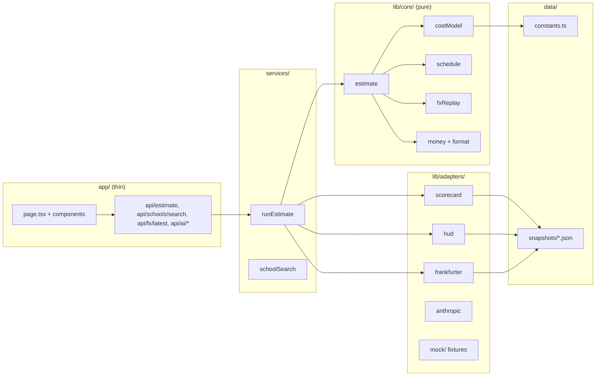

# Architecture

Three layers. Dependencies point inward only, enforced by an ESLint `no-restricted-imports`
rule on `lib/core`.

## Layers

- `lib/core/`: the cost model, calendar, payment schedule, FX replay, money arithmetic and
  formatting. Pure TypeScript, no I/O, no framework. `computeEstimate(input, context)` is the one
  entry point; everything the data layer fetched arrives as arguments. Unit, property and golden
  tests live here.
- `lib/adapters/`: one module per source behind an interface, each with a fixture-backed mock
  used in `DEMO_MODE` and tests (step 5).
- `services/`: `runEstimate()` gathers data with `Promise.allSettled`, so a failed source becomes
  a labelled estimate rather than an error (step 5).
- `app/`: routes that validate input with zod and call services; components that render.
- `lib/server/`: env, flags, rate limiting (two tiers), outbound HTTP allowlist, errors, logs,
  snapshot freshness.

## Money

Integer minor units everywhere (`Cents`, `Minor`), rounding in one place. See ADR 005 and
`docs/cost-model.md`.
